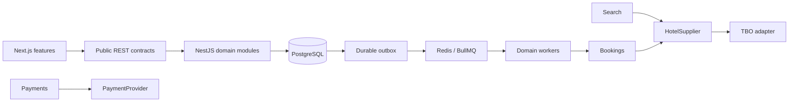

# Architecture

This repository contains one Next.js application and one NestJS API. The API is a
modular monolith with PostgreSQL as its durable source of truth and Redis for
short-lived search references and BullMQ delivery. There are no microservices.

## Find the right place to make a change

| Location                                               | Owns                                                                                 |
| ------------------------------------------------------ | ------------------------------------------------------------------------------------ |
| `apps/web/src/app`                                     | Pages, layouts, route composition, loading and error boundaries                      |
| `apps/web/src/features/<feature>`                      | Feature components, forms, queries, mutations, schemas and utilities                 |
| `apps/web/src/components/ui`                           | Reusable UI primitives                                                               |
| `apps/web/src/components/shared`                       | Shared layout and request/configuration feedback                                     |
| `apps/web/src/services/api`                            | HTTP transport, bearer tokens, response validation and domain API clients            |
| `apps/web/src/providers`                               | Clerk and TanStack Query providers                                                   |
| `apps/api/src/modules`                                 | Business domains listed below                                                        |
| `apps/api/src/common`                                  | Transport validation, authorization decorators, public errors and response envelopes |
| `apps/api/src/database`                                | The shared Prisma client lifecycle                                                   |
| `apps/api/src/infrastructure`                          | Redis connection and readiness checks                                                |
| `apps/api/src/jobs`                                    | Durable outbox publication and workflow workers                                      |
| `apps/api/prisma`                                      | PostgreSQL schema and migrations                                                     |
| `packages/contracts`                                   | Public Zod request/response schemas and inferred types                               |
| `packages/typescript-config`, `packages/eslint-config` | Shared compiler and lint settings                                                    |

Route files compose features; they do not own booking rules. React Hook Form and
Zod validate form inputs. The date picker selects a range and enforces stay rules;
it does not represent hotel inventory. TanStack Query manages API state near the
feature that consumes it. Its cache is not an authoritative price or booking store.

The API has these domain boundaries:

| Module          | Responsibility                                                                                     |
| --------------- | -------------------------------------------------------------------------------------------------- |
| `auth`          | Verify Clerk session tokens and enforce default authentication and roles                           |
| `users`         | Resolve Clerk identities to internal users and manage owned profiles                               |
| `hotels`        | Public hotel transport and the provider-neutral `HotelSupplier` interface                          |
| `search`        | Stay validation, search orchestration, opaque rate references and authenticated recheck            |
| `pricing`       | Checked minor-unit arithmetic, markup and durable owned price quotes                               |
| `tbo`           | Supplier authentication, wire DTO validation, mapping, transport and the TBO adapter               |
| `bookings`      | Intent creation, quote consumption, guest updates, supplier fulfillment and booking reconciliation |
| `customers`     | Guest and room occupancy validation                                                                |
| `payments`      | Checkout reservation, provider abstraction and verified webhook application                        |
| `notifications` | Confirmation delivery boundary; currently disabled                                                 |
| `admin`         | Server-authorized booking visibility                                                               |

Controllers only validate transport and delegate. Services use Prisma directly
where it is sufficient; there is no generic repository or base-service layer.
Supplier and payment interfaces exist because they isolate real external systems.

## Data and trust boundaries

All REST routes use `/api/v1`. Successful responses contain `{ data, requestId }`.
Errors contain `{ code, message, requestId, details? }`. A centralized filter turns
domain errors into this shape and avoids exposing unexpected exception messages.

The global authentication guard requires a verified Clerk user session unless a
route explicitly uses `@Public()`. Search and hotel details are public. Recheck,
quotes used for booking, bookings, profiles and checkout are associated with the
authenticated internal user. Admin permissions come from the internal user role.
Frontend route protection is an additional UI boundary, not the API authorization.

Search responses expose application `Hotel` and `HotelRate` models. Supplier DTOs
and booking codes remain inside the API. For each rate, search creates a random
UUID and caches the supplier reference, stay criteria and hotel identity in Redis
for 15 minutes. The browser receives only that UUID and a calculated display price.
The catalog uses supplier destination codes; a destination discovery/autocomplete
integration is an extension point, not seeded hotel inventory.

Authenticated recheck loads the cached rate, validates the stay again, asks the
supplier for its current offer, and verifies hotel/room/currency identity. It
creates a `PriceQuote` in PostgreSQL bound to the current user. The quote stores
normalized occupancy, supplier reference, component amounts, pricing rules,
cancellation policy snapshot and expiry. The browser can accept this quote ID;
it cannot submit an authoritative amount or supplier booking token.

The public currency set is USD, EUR, GBP, AED, PKR and INR. Every amount in a public
contract or money column is an integer in the currency's minor unit. Pricing
validates the currency, uses checked bounds, and calculates markup with integer
half-up rounding. Markup applies to base amount only; tax and fee components are
added once. Discounts are currently zero. No implicit foreign-exchange conversion
exists. Historical bookings retain the accepted price and policy snapshots.

Database models are not public API contracts. `User`, `CustomerProfile`,
`PriceQuote`, `Booking`, guests, rooms, payments, events, refunds, favorites,
`AuditLog` and `OutboxEvent` represent application data. The schema includes
ownership indexes, idempotency uniqueness and one payment reservation per booking.
Raw third-party payloads are not the primary model.

## External integrations and their current limits

`HOTEL_SUPPLIER` binds to `TboService`; application code depends on `HotelSupplier`.
The client uses configured HTTPS, Basic authentication, deadlines, redacted
context logging and bounded retries for explicitly allowlisted read operations.
No mutation can enter the read retry path. TBO read DTOs are candidate REST
integration shapes and are disabled by default with `TBO_READS_ENABLED=false`.

The public TBO portal documents SOAP v7, which does not certify this account's
JSON API contract. Obtain the agency's current REST specification and sandbox
fixtures before enabling reads. Validate endpoint routing, tax-inclusive fare
semantics, multi-room rates, policies, supplements and expiry. Read
[the TBO integration notes](../apps/api/src/modules/tbo/INTEGRATION.md) before
changing this boundary. TBO booking, lookup and cancellation remain explicitly
disabled even when read credentials are supplied.

`PAYMENT_PROVIDER` binds to a disabled adapter. The gateway interface covers
checkout, signed webhook verification, authoritative payment lookup and refunds.
No Stripe or other gateway secretly returns test success. Payment reconciliation,
refund processing and confirmation email workers preserve pending durable work
and report configuration errors until their adapters are implemented.

`JOBS_ENABLED=false` is the default. Enabling it starts one BullMQ queue and worker
inside the API process, with PostgreSQL outbox rows as the durable work record.
It does not enable unfinished integrations. See [booking flow](booking-flow.md)
for the transaction and recovery boundaries.

## Operational conventions

Environment validation lives in each app's `config` folder. Backend credentials
never belong in `NEXT_PUBLIC_*` variables. Logs allowlist request path, request ID,
operation and other safe context; they exclude bodies, headers, query strings,
guest details, provider payloads and secrets. Correlation IDs are generated on the
server and returned in the response header and envelope.

Unit tests cover money, supplier mapping/transport, opaque search references,
booking transitions, guest validation and webhook application. Transactional
integration tests require a dedicated PostgreSQL test database. Tests and builds
do not constitute supplier/gateway certification. Before live operation, finish
the adapters, verify end-to-end sandbox scenarios, and provide monitoring and an
operator workflow for unresolved outbox and reconciliation records.

## Supplier references

- [TBO public API specification portal](https://api.tbotechnology.in/AIS_APISpecification.aspx)
- [TBO certification and ambiguous-booking guidance](https://api.tbotechnology.in/AIS_Going-live-certification.aspx)
