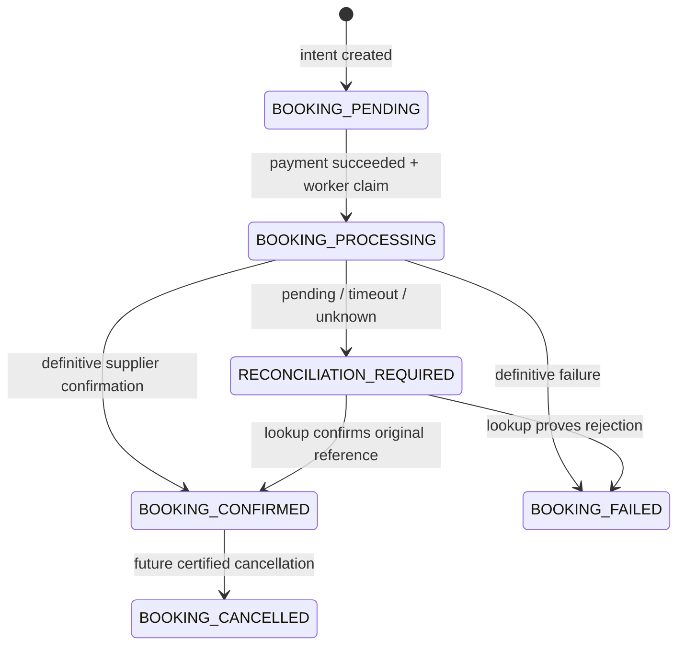

# Booking flow and recovery

The scaffold separates payment status from hotel booking status. A successful
payment is not a hotel confirmation. The UI displays the API's states and cannot
mark an operation successful itself. Live payment, TBO mutation, cancellation,
refund and email adapters still require implementation and certification.

## Request sequence

1. `GET /api/v1/hotels/search` validates dates, maximum stay, nationality and
   per-room occupancy. The backend calculates displayed totals and stores opaque
   rate references in Redis with a 15-minute lifetime.
2. `POST /api/v1/hotels/recheck` accepts only `rateId`. The API loads the stored
   criteria, asks the supplier for current availability/pricing and persists an
   owned `PriceQuote`. Its expiry uses `QUOTE_TTL_SECONDS` (default five minutes).
   The customer reviews this latest quote before accepting it.
3. `POST /api/v1/bookings` accepts `quoteId` and `idempotencyKey`. In one database
   transaction it verifies ownership/expiry, atomically consumes the unused quote,
   creates the booking and room snapshots, and writes an audit record. No supplier
   mutation occurs during intent creation.
4. `PATCH /api/v1/bookings/:id/guests` validates guests against the quoted room
   counts and child ages, requires one adult lead guest, and stores contact
   details. Guest edits are locked once a payment reservation exists.
5. `POST /api/v1/payments/checkout` verifies the booking, guests and quote expiry.
   It reserves one payment and durable reconciliation work in a transaction
   before calling the gateway. The gateway receives the stored total/currency
   and a stable payment ID as its idempotency key.
6. `POST /api/v1/payments/webhooks/:provider` receives the original raw body. Only
   the provider adapter may verify its signature and timestamp/replay policy and
   return a normalized event. A browser return URL never proves payment success.
7. The verified event is checked against the reserved payment's amount, currency
   and provider reference. Event persistence, payment/booking updates and a
   booking-fulfillment outbox event commit together.
8. A fulfillment worker claims the paid booking, verifies quote expiry, and
   rechecks supplier hotel, room, price and policies. It durably records the
   mutation dispatch boundary and sends at most one supplier booking request,
   using the booking ID as the client reference.
9. A confirmed supplier response with a booking reference updates the booking
   and schedules confirmation delivery in one transaction. Pending or ambiguous
   outcomes enter reconciliation; known failures request a refund.

## States

The separate payment states are `PAYMENT_PENDING`, `PAYMENT_SUCCEEDED`,
`PAYMENT_FAILED`, `REFUND_PENDING` and `REFUNDED`. A late valid success event can
advance an earlier failed payment; a later failure cannot regress a success.
Booking failure after payment atomically creates a `Refund`, moves booking and
payment to `REFUND_PENDING`, and schedules refund work. The current disabled
gateway does not execute refunds or set `REFUNDED`.

Cancellation has an API endpoint and a modeled state but deliberately returns a
configuration error. A future implementation must obtain current supplier
penalties, obtain the customer's acceptance where appropriate, and persist the
cancellation/refund outcomes. It must not simply change the local booking state.

## Idempotency and concurrency boundaries

| Operation                    | Protection                                                                                                 |
| ---------------------------- | ---------------------------------------------------------------------------------------------------------- |
| Create booking intent        | Unique `(userId, idempotencyKey)`, stored request hash, conditional quote consumption and unique `quoteId` |
| Edit guests / start checkout | Conditional booking update with version/status checks; guest editing requires no payment reservation       |
| Start payment                | Unique `bookingId` on `Payment`; reserve before gateway call; stable gateway idempotency key               |
| Apply webhook                | Unique `(provider, providerEventId)`; duplicate payload hash check; conditional status updates             |
| Start supplier booking       | Conditional paid-booking claim, persisted dispatch timestamp and original client reference                 |
| Schedule background work     | Outbox row committed with domain changes; unique dedupe key and stable BullMQ job ID                       |
| Request refund               | Conditional failure transition and unique refund idempotency key                                           |

Reuse the original key when retrying a user request. Reusing a booking key with a
different quote is rejected. A payment checkout that already exists must be
resumed with its original key. The server does not create another charge when an
external checkout response is lost. A concurrent checkout may initially receive a
conflict; a later retry with the original key reads the durable reservation.

Database transactions do not span supplier/gateway network calls. That avoids
holding database locks across unpredictable remote calls, but requires explicit
handling of the gap between a remote effect and recording its result.

## Unknown outcomes and background delivery

A supplier timeout does not establish that booking failed. Once dispatch is
recorded, the system never automatically calls `createBooking` again. It asks
`getBooking` using the same client reference. A temporary absence or non-final
response must map to `pending`; only a definitive rejection may map to `failed`.

The initial reconciliation event waits 15 minutes for bounded pre-dispatch work.
At dispatch, a transaction stamps `supplierAttemptedAt` and moves the check to a
five-minute grace period. The dispatch update is conditional on the booking still
being paid and processing. A stale worker therefore cannot dispatch after a
concurrent recovery has already failed/refunded the booking. A stale claim with
no dispatch timestamp can safely enter the refund path, subject to that same
conditional update. A claim with a timestamp is ambiguous even if the process
crashed immediately before its network request.

Any future supplier mutation must have a hard timeout shorter than that grace
period. Adjust both if the certified provider contract needs different timing.
Do not treat eventual-consistency "not found" as permission to rebook or refund.

PostgreSQL `OutboxEvent` rows hold pending work; Redis is the delivery mechanism.
When enabled, the publisher polls every five seconds. A worker marks an event
complete only after the domain handler succeeds. Failures retain safe error codes
and use delayed exponential retry, capped at eight failed attempts; exhausted
rows remain in PostgreSQL for operator review. Disabled refund, gateway
reconciliation and email handlers fail explicitly instead of reporting delivery.

This is at-least-once delivery. Every future external handler needs its own stable
idempotency key or outcome reconciliation. Confirmation email adapters should use
the booking ID. Refund adapters should use the persisted refund key and verify an
unknown result before attempting another refund.

## Extending and operating the workflow

- Implement wire formats only inside the supplier/gateway adapters and validate
  real sandbox fixtures before enabling them.
- Verify gateway lookup amount, currency and original payment ID before applying
  reconciliation results through the same idempotent state-change boundary.
- Exercise duplicate and out-of-order webhooks, concurrent intent/checkout
  requests, price/policy changes, unavailable rooms, process crashes and supplier
  timeouts against a dedicated test database and provider sandbox.
- Monitor pending reconciliation, refund and exhausted outbox records. Investigate
  the original supplier/payment references before changing their states. Deleting
  a reservation or creating a fresh key is not a safe retry strategy.
- Keep payment and booking statuses separate in UI and reports. Show a hotel
  confirmation only when the API reports `BOOKING_CONFIRMED`.

See [architecture](architecture.md), [development](development.md), and
[TBO integration notes](../apps/api/src/modules/tbo/INTEGRATION.md) for the related
boundaries and configuration.
